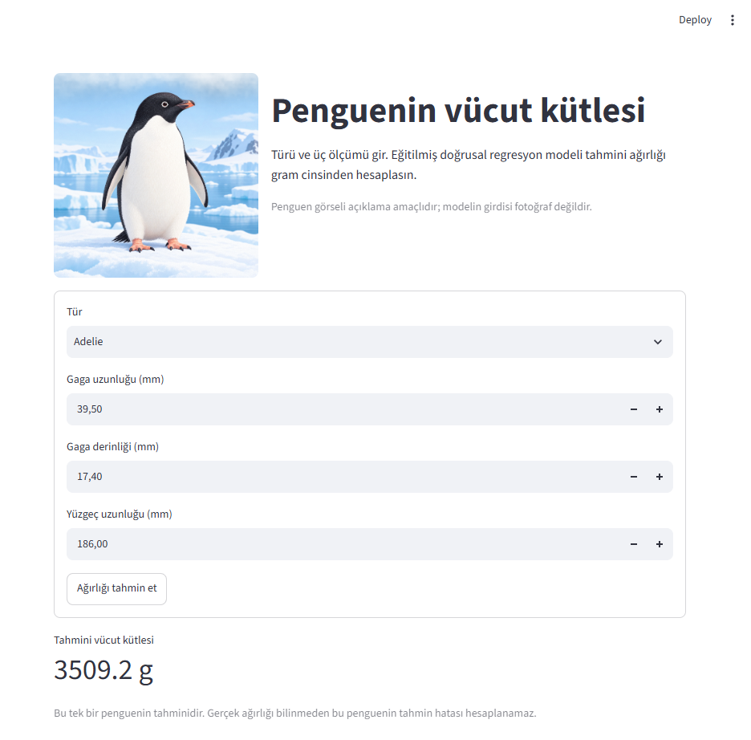

# Penguin Body Mass Prediction

Palmer Penguins veri setindeki tür ve üç vücut ölçümünden bir penguenin vücut kütlesini gram cinsinden tahmin eden eğitim projesi. Amaç yalnızca bir model çalıştırmak değil; ham veriden tahmine kadar her kararın nedenini ve sonucunu görünür kılmak.

**Canlı uygulama:** [Penguen vücut kütlesi tahmini](https://penguin-mass-gclhx8xd3usgjyotmk4u6n.streamlit.app/)



## Veri ve problem

Veri setinde 344 penguen kaydı ve 8 sütun bulunur. Hedef değişken `body_mass_g` değeridir. Bu değer 2 kayıtta eksik olduğu için modelleme 342 kayıtla yapılır. Modelin girdileri `species`, `bill_length_mm`, `bill_depth_mm` ve `flipper_length_mm` sütunlarıdır; tahmin sırasında gerçek ağırlık girdi olarak kullanılmaz.

Keşif analizinde Gentoo penguenlerinin ağırlık dağılımının diğer iki türden belirgin biçimde farklı olduğu görüldü. Yüzgeç uzunluğu ile ağırlık arasındaki genel korelasyon 0.871 iken tür içindeki ilişkiler daha zayıftır. Gaga derinliği ile ağırlık arasındaki genel korelasyon −0.472, tür ortalamaları çıkarıldığında ise 0.622’dir. Bu karşıtlık, bir ilişkiyi yorumlarken tür gibi grup bilgisini göz ardı etmemek gerektiğini gösterdi. Analiz ve grafikleri [`notebooks/analysis.ipynb`](notebooks/analysis.ipynb) içerir.

## Modelleme ve sonuçlar

Ağırlığı bilinen 342 kayıt, sabit bir rastgele seçimle 274 eğitim ve 68 test kaydına ayrıldı. İlk karşılaştırma için eğitim kümesinin ortalama ağırlığını her penguene söyleyen bir baseline kuruldu. Daha sonra tek özellikli doğrusal regresyon elle hesaplandı ve gradient descent ile öğrenme süreci küçük ölçekte gösterildi. Son model, sayısal ölçümleri ve türün kategorik dönüşümünü bir scikit-learn pipeline içinde birleştirir; dönüşümler yalnızca eğitim verisinde öğrenilir.

| Model | Test MAE | Test RMSE |
| --- | ---: | ---: |
| Eğitim ortalaması baseline | 631.1 g | 742.5 g |
| Yalnızca yüzgeç uzunluğu ile doğrusal regresyon | 274.6 g | 359.0 g |
| Üç ölçüm ve tür ile doğrusal regresyon pipeline’ı | 215.9 g | 280.3 g |

MAE, mutlak hataların ortalamasıdır. RMSE, büyük hatalara daha fazla ağırlık verir. Türlere göre ve tahmin edilen ağırlığa göre artıklar ayrıca incelenmiştir; tek tek penguenlerde ortalama hatadan belirgin biçimde büyük sapmalar bulunabilir.

## Çalıştırma

Python 3.14 ile proje kökünde sanal ortam oluşturun:

```powershell
python -m venv .venv
.\.venv\Scripts\python.exe -m pip install -r requirements.txt
.\.venv\Scripts\python.exe .\src\train.py
.\.venv\Scripts\python.exe .\src\predict.py
.\.venv\Scripts\python.exe -m unittest discover -s tests -p "test_*.py" -v
.\.venv\Scripts\python.exe -m streamlit run .\app.py
```

`train.py` veriyi okuyup modeli eğitir, değerlendirme sonuçlarını gösterir ve pipeline’ı `model/model.joblib` dosyasına kaydeder. `predict.py` kayıtlı modeli yükler; penguenin türünü, gaga uzunluğunu, gaga derinliğini ve yüzgeç uzunluğunu isteyerek tahmini gram cinsinden gösterir. Veri yükleme ve aynı eğitim/test ayrımını üretme mantığı `src/data.py` içindedir.

## Değerlendirmenin sınırları

Bu sonuçlar küçük bir veri setindeki tek bir eğitim/test ayrımına aittir. Test kayıtları modelin `fit` işleminde kullanılmadı; ancak proje boyunca farklı model sürümlerinin sonuçları aynı test kümesinde görüldü. Bu nedenle 215.9 g MAE, tamamen bağımsız ve daha önce hiç danışılmamış bir dış veri kümesindeki başarı garantisi olarak yorumlanmamalıdır. Model yalnızca veride bulunan üç tür ve benzer ölçüm koşulları için geliştirilmiştir; olağan dışı ölçümlere yapılan tahminler güvenilir olmayabilir.

## Veri kaynağı

Palmer Penguins verileri Kristen Gorman ve Palmer Station Antarctica LTER tarafından toplanıp erişime açılmış, [palmerpenguins projesi](https://github.com/allisonhorst/palmerpenguins) aracılığıyla yaygınlaştırılmıştır. Özgün çalışma ve türlere ait veri atıfları kaynak projenin README dosyasında yer alır.